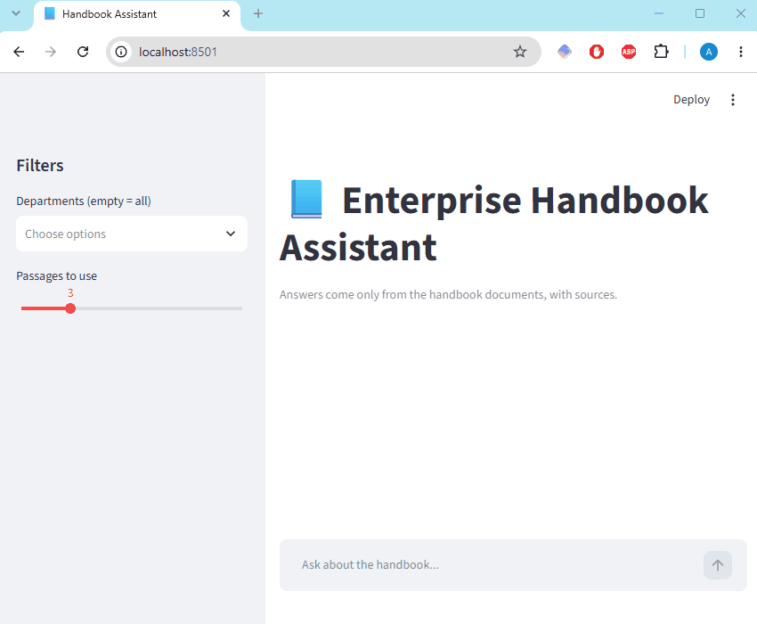
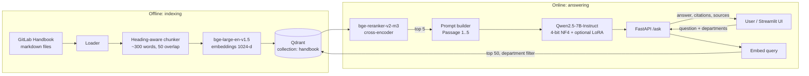

# LLM Enterprise Assistant

A retrieval-augmented question-answering assistant for internal company documentation, with a QLoRA-fine-tuned generator, a measured evaluation harness, and a one-command Docker deployment. It runs fully locally on a single consumer GPU. No data leaves the machine.

The demo corpus is a subset of the public [GitLab Handbook](https://handbook.gitlab.com/) (9 departments, about 13k chunks). It is a realistic stand-in for an enterprise knowledge base: long, overlapping policy pages that change often.



---

## Contents

1. [The business problem](#1-the-business-problem)
2. [Solution overview](#2-solution-overview)
3. [Architecture](#3-architecture)
4. [Pipeline in detail](#4-pipeline-in-detail)
5. [Evaluation methodology and metrics](#5-evaluation-methodology-and-metrics)
6. [Improving retrieval](#6-improving-retrieval)
7. [Improving answers: prompt engineering](#7-improving-answers-prompt-engineering)
8. [Fine-tuning with QLoRA](#8-fine-tuning-with-qlora)
9. [Results](#9-results)
10. [Quick start (Docker)](#10-quick-start-docker)
11. [Running without Docker](#11-running-without-docker)
12. [API reference](#12-api-reference)
13. [Reproducing the experiments](#13-reproducing-the-experiments)
14. [Repository layout](#14-repository-layout)
15. [Testing and CI](#15-testing-and-ci)
16. [Cost estimation for a real deployment](#16-cost-estimation-for-a-real-deployment)
17. [Full tech stack](#17-full-tech-stack)
18. [Possible next steps](#18-possible-next-steps)

---

## 1. The business problem

Employees lose time finding answers that already exist somewhere in internal documentation: *"Can I expense a software subscription?"*, *"How long is the probation period if I move countries?"*, *"Do I get a referral bonus for a friend of a friend?"*

- **Search is keyword-based and page-oriented.** The answer is often one sentence in the middle of a long policy page, and the employee's wording rarely matches the document's wording.
- **Asking a colleague or HR does not scale.** It interrupts people, and the answers are inconsistent.
- **A plain LLM chatbot is risky.** Without grounding it invents policy. A wrong answer about expenses, leave or compliance is worse than no answer.
- **Sending company documents to a hosted API is often not allowed.** Handbooks, HR and legal content are confidential.

What an enterprise needs is an assistant that:

| Requirement | How this project addresses it |
|---|---|
| Answers from company documents, not from the model's memory | Retrieval-augmented generation over a vector index |
| Can be checked | Every answer cites the passages it used, and the UI shows the sources |
| Says "I don't know" when the documents don't cover it | A strict prompt and a fine-tune, evaluated on unanswerable questions |
| Keeps data private | Everything runs locally: open-weight models, local vector DB, no external API |
| Is measurable | A labelled evaluation set, retrieval and answer metrics, and an LLM judge |
| Is easy to deploy | Docker Compose with an indexer, API and UI |

---

## 2. Solution overview

A user asks a question, optionally restricted to one or more departments. The system:

1. embeds the question and retrieves the 50 most similar chunks from Qdrant,
2. reranks them with a cross-encoder and keeps the best 5,
3. gives those 5 passages to Qwen2.5-7B-Instruct with a strict grounding prompt,
4. returns a cited answer plus the source documents, or an explicit refusal if the passages don't contain the answer.

The generator can optionally load a **QLoRA adapter** trained on this corpus. The adapter ships in the repo (about 81 MB), so a cloned repo can use it without retraining.

---

## 3. Architecture



Components:

| Component | Technology |
|---|---|
| Embeddings | `BAAI/bge-large-en-v1.5` |
| Vector store | Qdrant, cosine distance, payload index on `department` |
| Reranker | `BAAI/bge-reranker-v2-m3` |
| Generator | `Qwen/Qwen2.5-7B-Instruct`, 4-bit NF4 with double quantisation, greedy decoding |
| Fine-tuning | Hugging Face TRL `SFTTrainer` and PEFT (QLoRA), tracked with MLflow |
| Judge (evaluation only) | `microsoft/phi-4`, 4-bit |
| API | FastAPI with models loaded once at startup |
| UI | Streamlit, a thin client of the API |
| Packaging | Multi-stage Dockerfile (uv) and Docker Compose |

---

## 4. Pipeline in detail

### 4.1 Ingestion and chunking

- `src/data/download_handbook.py` fetches the handbook sources for the 9 departments (engineering, people-group, finance, legal, security, support, people-policies, total-rewards, hiring).
- `src/data/loader.py` turns each markdown file into a `Document` (title, department, source path, text).
- `src/data/chunker.py` splits **on markdown headings first**, then packs paragraphs up to about 300 words with 50 words of overlap. Over-long paragraphs are split by line, then sentence, then word count. Chunks under 20 words are dropped.
- Each chunk is prefixed with `Document title > Section heading`, so a passage like "The limit is $5,000" still carries the context of what it is about. This helps both embedding and the reader.

### 4.2 Indexing

`src/retrieval/build_index.py` embeds all chunks with bge-large (batches of 256) and upserts them into the Qdrant collection `handbook`, with the chunk text, source, department, title and section stored as payload. The collection is recreated on each run.

### 4.3 Retrieval and reranking

1. **Dense retrieval.** The query is embedded with the BGE query instruction and the top **50** chunks are fetched, with an optional `department` filter.
2. **Cross-encoder reranking.** `bge-reranker-v2-m3` scores each (question, chunk) pair jointly and the top **5** are kept.

The reason for two stages is that bi-encoders are fast but coarse, while cross-encoders are accurate but too slow to run over the whole corpus. The cheap stage gets recall, the accurate stage gets precision (see [section 6](#6-improving-retrieval)).

### 4.4 Generation

`src/models/rag.py` builds a chat prompt with the system instructions and the five passages labelled `Passage 1` to `Passage 5`. The prompt requires the model to:

- answer **only** from the passages,
- answer in **full sentences** with citations (`[1]`, `[2]`),
- answer when the answer is **implied** by the passages, not only when it is stated verbatim,
- otherwise reply with exactly: *"I don't have enough information in the provided documents to answer that."*

Qwen2.5-7B runs in 4-bit NF4 (about 5 to 6 GB of VRAM) with greedy decoding for reproducibility. If `ADAPTER_PATH` is set, the LoRA adapter is loaded on top with PEFT.

### 4.5 Serving

- **FastAPI** (`src/api/main.py`) loads the embedder, reranker and LLM once in a lifespan hook and exposes `/health`, `/departments` and `/ask`.
- **Streamlit** (`src/api/app.py`) lets the user pick departments, ask a question and see the answer, citations and expandable source passages.

---

## 5. Evaluation methodology and metrics

You cannot improve what you do not measure, so the evaluation harness came before any tuning.

### 5.1 The evaluation set

`data/eval/hard_questions.jsonl` contains **99 questions: 80 answerable and 19 unanswerable.**

- Questions were generated by an LLM from randomly sampled chunks, then filtered and edited by hand.
- They are written **in the style of real employees**: paraphrased, situational (*"Can my kids use the counselling perk too?"*) and yes/no, rather than copying the document's wording. This matters because easy questions that reuse the document's phrasing make retrieval look better than it is.
- Each answerable question has a **reference answer** and a **source document**. Unanswerable questions have no source and the correct behaviour is to refuse.
- One question was found to be wrongly labelled unanswerable and was removed from the unanswerable set.

### 5.2 Retrieval metrics

Computed per question, where "relevant" means the labelled source document appears in the results.

| Metric | Meaning |
|---|---|
| **hit@k** | Fraction of questions where the correct source is in the top *k* results. hit@5 is the one that matters most, because 5 passages are what the generator sees. |
| **MRR** (mean reciprocal rank) | The average of 1 / (rank of the first correct result). It rewards putting the right document at rank 1, not just somewhere in the top *k*. |

### 5.3 Answer metrics

Each generated answer is scored by rules plus an LLM judge:

| Metric | Meaning | How it is computed |
|---|---|---|
| **Correct** | The answer agrees with the reference answer | Phi-4 judge, answerable questions only. Refusals count as incorrect. |
| **Correct (source in context)** | Correctness restricted to questions where retrieval found the right document | Separates generator errors from retrieval errors. |
| **Correct (answered only)** | Correctness among questions the model did not refuse | Shows answer quality when it commits to an answer. |
| **False refusals** | Refused although the answer was available | Regex on the refusal sentence, answerable questions. Lower is better. |
| **Correct refusals** | Refused when it should have | Regex on the refusal sentence, unanswerable questions. Higher is better. |
| **Faithful** | Every claim in the answer is supported by the retrieved passages | Phi-4 judge on non-refused answers. Catches hallucination. |
| **Cited** | The answer contains a real citation marker that matches a passage | Regex check. |

The central tension is **false refusals against hallucination**. A model can trivially score a perfect "correct refusals" by refusing everything, so both must be read together.

### 5.4 Methodological notes

- **One fixed judge, question set, `top_k` and prompt** across every comparison, so differences come from the change being tested.
- **The judge runs as a separate process** from generation, because both do not fit in VRAM together.
- Evaluation questions are **excluded from fine-tuning data** (see [section 8](#8-fine-tuning-with-qlora)).
- `src/evaluation/report.py` regenerates all tables in [`docs/results.md`](docs/results.md).

---

## 6. Improving retrieval

Measured on the 80 answerable questions with a labelled source:

| Retrieval | hit@1 | hit@3 | hit@5 | hit@10 | MRR |
|---|---|---|---|---|---|
| Dense (bge-large) | 0.55 | 0.70 | 0.79 | 0.88 | 0.653 |
| **Dense + rerank** | **0.81** | **0.90** | **0.91** | **0.95** | **0.857** |
| Hybrid (dense + BM25, RRF) | 0.55 | 0.75 | 0.82 | 0.88 | 0.662 |
| Hybrid + rerank | 0.81 | 0.90 | 0.93 | 0.95 | 0.859 |

**What worked: cross-encoder reranking.** hit@5 rose from 0.79 to 0.91 and MRR from 0.653 to 0.857. It is the largest single retrieval gain.

**What didn't: hybrid search.** Adding BM25 keyword search fused with Reciprocal Rank Fusion gave about +0.03 on hit@5, and almost nothing after reranking (0.91 to 0.93, within noise at n=80). Hybrid search needs an in-memory BM25 index over all chunks, so the production pipeline stays **dense + rerank**. I kept the negative result because it avoided shipping extra complexity for no measurable gain.

**Candidate pool size.** The reranker can only reorder what it is given. `src/evaluation/candidate_depth.py` measures how recall changes with pool sizes of 10, 20, 30, 50 and 100. The pipeline uses a pool of 50.

**What is left.** About 7 of 80 answerable questions still have the source outside the top 5. These are retrieval misses that no generator improvement can fix.

---

## 7. Improving answers: prompt engineering

The first answer evaluation (prompt v1) scored 0.75 correct with a **15% false-refusal rate**. A breakdown of the 20 failures showed that **15 of them happened with the right passage in context**, so the generator, not retrieval, was at fault. There were two causes:

1. **Over-refusal.** The model refused when the answer was implied rather than stated.
2. **Citation-only answers.** The answer was just `[1]` with no sentence.

Prompt v2 changed the following:

- passages are labelled `Passage N`,
- answers must be full sentences with citations,
- the model must answer when the passages imply the answer,
- the refusal sentence is reserved for when the passages truly do not cover the question.

Result: **correct 0.75 to 0.84, false refusals 0.15 to 0.06**, with correct refusals unchanged at 0.95. Faithfulness fell from 0.97 to 0.91, which is the expected cost of a model that commits to more answers.

The refusal and citation checks were made stricter at the same time (`is_refusal`, `has_real_citation`), because the first versions mislabelled some answers.

---

## 8. Fine-tuning with QLoRA

### 8.1 Goal

Teach the 7B model the exact behaviour wanted from this task: answer in the grounded, cited style, commit when the answer is implied, and refuse only when the passages don't cover the question, **without** the prompt having to carry all of that.

### 8.2 Method

- **QLoRA:** the base model is loaded in 4-bit NF4 and frozen, and small LoRA matrices are trained on top. This fits on a 16 GB consumer GPU.
- **Configuration** (`configs/model_config.yaml`): rank 16, alpha 32, dropout 0.05, all attention and MLP projections (`q,k,v,o,gate,up,down`), learning rate 1e-4, effective batch size 16 (batch 1 with 16 gradient accumulation steps), max length 3072.
- **Prompt/completion format**, so the loss is computed on the **answer tokens only**, not on the long retrieved context.
- **Tracking:** MLflow.

### 8.3 Training data: self-distillation through the real pipeline

No human-written answers exist for this corpus, so the training set is built from the system itself:

1. Generate questions from handbook documents. **Every document used by the evaluation set is excluded, to prevent leakage.**
2. For each question, run the **real retrieval pipeline** (dense 50, rerank 5) so the training contexts look exactly like production contexts.
3. Generate an answer with Qwen and prompt v2.
4. **Filter** the examples with the Phi-4 judge, keeping the ones that are correct and faithful.
5. Add **refusal examples** by removing the source document from the retrieved pool, so the correct answer really is "I don't know".

### 8.4 Two improvment attemts

| | Data | Outcome |
|---|---|---|
| **v1** | 845 train examples, 14% refusals, mostly easy factual questions | **Worse than the baseline.** False refusals rose to 0.20 and correct fell to 0.74. |
| **v2** | 1,363 train and 73 val examples. 700 hard questions (yes/no, "Can I...", situational, paraphrased) added, and refusals cut to 5%. 1 epoch. | **Best model.** Correct 0.86, correct with source in context 0.90. |

**Why v1 failed:** too many easy refusal examples taught the model that refusing is a safe default, and there were no hard or implied-answer questions to teach it to commit. v2 fixed both the *share* of refusals and the *difficulty* of the questions.

Training data lessons:

- The balance of refusals and the difficulty of the questions decide the over-refusal behaviour.
- A fine-tune cannot fix retrieval misses.

The v2 adapter is committed at `models/qwen-handbook-lora-v2/` (`adapter_config.json` and `adapter_model.safetensors`, about 81 MB). The base model is referenced by its Hugging Face ID, so the adapter works on any machine.

---

## 9. Results

Answer quality on the hard set (80 answerable, 19 unanswerable):

| Run | Correct | Correct (source in context) | Correct (answered only) | False refusals | Correct refusals | Faithful | Cited |
|---|---|---|---|---|---|---|---|
| Baseline (prompt v1) | 0.75 | 0.79 | 0.88 | 0.15 | 0.95 | 0.97 | 1.00 |
| Prompt v2 | 0.84 | 0.88 | 0.89 | 0.06 | 0.95 | 0.91 | 0.99 |
| Fine-tuned v1 | 0.74 | 0.81 | 0.92 | 0.20 | 1.00 | 0.94 | 1.00 |
| **Fine-tuned v2** | **0.86** | **0.90** | **0.93** | 0.07 | 0.95 | 0.93 | 0.99 |

Reading the table:

- **Prompt engineering gave the biggest jump** (+0.09 correct, false refusals cut by more than half) for no training cost.
- **Fine-tuned v2 is the best run**, but its gain over prompt v2 (+0.02 correct) is **within noise at n=80**. Its more reliable benefits are higher faithfulness (0.93 against 0.91) and a better correct-when-answered rate (0.93 against 0.89).
- **Fine-tuned v1 shows how fine-tuning can hurt**: perfect refusals (1.00) came at the price of 20% false refusals.
- **The main remaining error source is retrieval**, with the source missing from the top 5 for about 9% of questions.

The full tables are regenerated with `uv run python -m src.evaluation.report` and saved in [`docs/results.md`](docs/results.md).

---

## 10. Quick start (Docker)

### Requirements

- Docker with Docker Compose
- An NVIDIA GPU with working GPU support in Docker (NVIDIA Container Toolkit, or Docker Desktop with the WSL2 GPU backend). 16 GB VRAM is what this was developed on. The 4-bit generator, embedder and reranker are expected to run in less, but that has not been tested.
- About 30 GB of free disk for images, models and the index. The first start downloads the models, which takes a while.

### Steps

```bash
git clone https://github.com/AntekBall/LLM-enterprise-assistant.git
cd LLM-enterprise-assistant

# 1. Start the vector database
docker compose -f docker/docker-compose.yml up -d qdrant

# 2. One-time setup: download the handbook and build the index (a few minutes on GPU)
docker compose -f docker/docker-compose.yml --profile setup run --rm --build indexer

# 3. Start the API and UI with the base model
docker compose -f docker/docker-compose.yml up --build
```

To serve the **fine-tuned model** instead, add the override file:

```bash
docker compose -f docker/docker-compose.yml -f docker/docker-compose.finetuned.yml up --build
```

Then open:

- **UI:** http://localhost:8501
- **API docs:** http://localhost:8000/docs

The first request is slow because the models are loaded and cached. Later requests are fast.

Check the index and the API:

```bash
curl http://localhost:6333/collections/handbook   # points_count should be ~13k
curl http://localhost:8000/health
```

> **Warning:** do not run `docker compose down -v`. It deletes the `hf_cache` volume (the downloaded models) and the `qdrant_data` volume (the index), and both are slow to rebuild. Use `docker compose down` or `stop`.

---

## 11. Running without Docker

Faster to start and iterate. Qdrant still runs in Docker.

Requirements: Python 3.10+, [uv](https://docs.astral.sh/uv/), an NVIDIA GPU with CUDA 12.8 drivers.

```powershell
uv sync --extra dev

# Vector DB
docker compose -f docker/docker-compose.yml up -d qdrant

# Download the corpus and build the index (once)
uv run python -m src.data.download_handbook
uv run python -m src.retrieval.build_index

# API (add ADAPTER_PATH to use the fine-tuned model)
$env:ADAPTER_PATH = "models/qwen-handbook-lora-v2"
uv run uvicorn src.api.main:app --port 8000

# UI, in a second terminal
uv run streamlit run src/api/app.py
```

Environment variables:

| Variable | Default | Purpose |
|---|---|---|
| `QDRANT_URL` | `http://localhost:6333` | Qdrant location |
| `ADAPTER_PATH` | unset | Path to a LoRA adapter. Unset means the base model. |
| `API_URL` | `http://localhost:8000` | Where the UI finds the API |

---

## 12. API reference

| Endpoint | Method | Description |
|---|---|---|
| `/health` | GET | Liveness and readiness check |
| `/departments` | GET | Departments available for filtering |
| `/ask` | POST | Ask a question |

Example:

```bash
curl -X POST http://localhost:8000/ask \
  -H "Content-Type: application/json" \
  -d '{"question": "Do I have to keep receipts for small card purchases?", "departments": ["finance"]}'
```

The response contains the answer text, whether it was a refusal, and the source passages used. See `/docs` for the exact schema.

On Windows PowerShell, `curl` is an alias for `Invoke-WebRequest`. Use `curl.exe` or `Invoke-RestMethod`.

---

## 13. Reproducing the experiments

All commands use `uv run`. GPU is required for generation and judging, and Qdrant must be running with the full index.

```bash
# Retrieval metrics (dense, rerank, hybrid)
uv run python -m src.evaluation.evaluate_retrieval data/eval/hard_questions.jsonl dense+rerank

# Answer generation and judging (separate processes, because of VRAM)
uv run python -m src.evaluation.evaluate_answers
uv run python -m src.evaluation.judge_answers

# All tables
uv run python -m src.evaluation.report

# Build the fine-tuning data
uv run python -m src.data.build_train_questions
uv run python -m src.data.build_train_examples
uv run python -m src.data.build_hard_questions
uv run python -m src.data.build_hard_examples
uv run python -m src.data.filter_train
uv run python -m src.data.merge_train

# Train (about 1 epoch on 1,363 examples)
uv run python -m src.models.train_lora

# Inspect training runs
uv run mlflow ui
```

Some scripts take arguments for input and output paths. Check the top of each file.

---

## 14. Repository layout

```
.
├── .github/workflows/ci-cd.yml   # lint, format check, tests, Docker build
├── configs/
│   ├── model_config.yaml         # QLoRA hyperparameters and paths
│   └── rag_config.yaml
├── data/
│   ├── eval/                     # hard question set and saved judged results
│   ├── train/                    # fine-tuning data (v1, hard, merged v2)
│   ├── raw/                      # downloaded handbook (git-ignored)
│   └── processed/                # intermediate files (git-ignored)
├── docker/
│   ├── Dockerfile                # multi-stage, uv
│   ├── docker-compose.yml        # qdrant, indexer (setup profile), api, ui
│   └── docker-compose.finetuned.yml
├── docs/
│   ├── Model_showcase.gif        # demo
│   └── results.md                # generated metric tables
├── models/qwen-handbook-lora-v2/ # the trained LoRA adapter
├── notebooks/                    # exploration and RAG experiments
├── src/
│   ├── data/                     # download, load, chunk, training-data builders
│   ├── retrieval/                # embedder, Qdrant store, hybrid, reranker, index builder
│   ├── models/                   # rag.py (prompt and pipeline), inference.py, train_lora.py
│   ├── evaluation/               # retrieval and answer evaluation, judge, report
│   └── api/                      # FastAPI backend and Streamlit UI
├── tests/
├── pyproject.toml
└── uv.lock
```

---

## 15. Testing and CI

```bash
uv run pytest
uv run ruff check .
uv run ruff format --check .
```

There are 22 unit tests covering the loader, chunker, prompt and retrieval logic, the evaluation regexes and the API (with mocked models). GitHub Actions runs lint, format check and tests on every push, using CPU-only PyTorch, and builds the Docker image on pushes to `main`.

---

## 16. Cost estimation for a real deployment

This is a planning estimate, not a measurement. Prices are rounded, illustrative figures that change often, so check current vendor pricing before budgeting. Latency and throughput were **not benchmarked** in this project. Measure them on your hardware before sizing a deployment.

### 16.1 Usage assumptions

| Assumption | Value | Basis |
|---|---|---|
| Questions per employee per month | 4 (about one a week) | Assumed. Adoption varies a lot. |
| Prompt size | about 2,400 tokens | System prompt plus 5 passages of up to about 300 words each plus the question |
| Answer size | about 150 tokens | Full sentences with citations |
| Corpus | about 13k chunks | The demo handbook. A real company might have 5 to 50 times more. |

Monthly questions = employees × 4. For 200, 1,000 and 5,000 employees that is 800, 4,000 and 20,000 questions.

### 16.2 What the infrastructure needs

- **Qdrant:** 13k vectors of 1,024 floats is about 55 MB plus payload text, so a few hundred MB. Even 50 times the corpus fits on a small VM. It is a negligible cost.
- **GPU:** one process holds the 4-bit Qwen2.5-7B generator, the embedder and the reranker. A **24 GB class GPU** (L4, A10, RTX 4090 or similar) gives comfortable headroom. Development was on a 16 GB card.
- **Compute is the dominant infrastructure cost.** Storage, networking and the vector DB are small by comparison.

### 16.3 Three ways to run it

| Option | Fixed monthly cost | Variable cost | Data stays in-house |
|---|---|---|---|
| **A. On-premises GPU server** (this project's design) | about $85 to $140 hardware amortised (a $3k to $5k server over 3 years) plus about $40 power | None | Yes |
| **B. Cloud GPU VM**, 24 GB class at about $0.8 per hour | about $580 running 24/7, about $175 for business hours only (about 220 h) | None | Yes, inside your own cloud tenancy |
| **C. Hosted LLM API** instead of the local generator | None | Per token, see below | **No**, prompts leave the company |

Option C, per question at about 2,400 input and 150 output tokens:

| Model class (illustrative price per 1M input / output tokens) | Cost per question | 800 q/mo | 4,000 q/mo | 20,000 q/mo |
|---|---|---|---|---|
| Small model, about $0.15 / $0.60 | about $0.0005 | about $0.40 | about $2 | about $9 |
| Frontier model, about $3 / $15 | about $0.009 | about $8 | about $38 | about $190 |

Embedding and reranking can stay local on a much smaller GPU, or run on CPU at low volume.

**Reading the comparison**
- At these volumes a **hosted API is far cheaper** than a dedicated GPU, because a GPU costs the same whether it handles 800 questions or 20,000. A GPU only becomes cost-competitive at very high volume or with a frontier-class model.
- The reason to self-host is **data control, not price.** Handbooks, HR and legal content are often not allowed to leave the company. That requirement is what this project was designed around.
- **A middle path** is worth considering: a hosted model under an enterprise agreement with a no-retention clause, or a private endpoint in your own cloud account.

### 16.4 Capacity

The API uses Hugging Face `generate` with no request batching, so concurrent users queue behind each other.

- If one answer takes about 10 seconds (an assumption to be replaced by a measurement), one GPU serves about 360 questions per hour.
- At 20,000 questions a month (about 900 per working day), the average load is light, but peaks matter more than averages. Size for the busiest hour, for example the start of the working day.
- Beyond a few thousand daily users, or if latency matters, move generation to a batching server such as vLLM, which typically serves several times more requests per GPU, or add GPU replicas behind a load balancer. The retrieval and prompt code is unchanged by that.

### 16.5 One-off and recurring costs beyond hosting

| Item | Estimate |
|---|---|
| Initial indexing | Minutes of GPU time per 13k chunks. Re-run on a schedule or when documents change. |
| Fine-tuning | One QLoRA run took about 75 minutes on a consumer GPU. Renting a 24 GB cloud GPU for a run costs on the order of a few dollars. Retrain only when the corpus or behaviour changes substantially. |
| Evaluation | A GPU run for generation and a second for the judge, each a few minutes at 100 questions. Cheap, but **building a good labelled set takes human time**. |
| Engineering to productionise | Document connectors, per-user access control, authentication, logging, monitoring and an update pipeline. This is not in the demo and is the largest one-off cost. |
| Ongoing maintenance | A realistic allowance is 0.1 to 0.25 of an engineer: keeping the index fresh, reviewing failures, refreshing the evaluation set and upgrading models. |

### 16.6 Is it worth it?

Infrastructure is small next to the value of the time saved. Take the 1,000-employee case with an assumed **5 minutes saved per answered question** and a **loaded cost of $50 per hour**:

- 4,000 questions × 5 min = about 333 hours a month, or about $16,700 of employee time.
- Even if only a quarter of that is real saving, it is about $4,000 a month, against roughly $175 to $600 of compute (option A or B).

Engineering and maintenance people-cost is the real budget item, not the GPU. The estimate also depends heavily on **answer quality and trust**. Section 9 shows about 86% correct answers on a hard set, so users still need the citations to check important answers. A wrong answer about policy has a cost that this arithmetic does not capture.

### 16.7 Cost levers

- Use a smaller model, or shorter prompts (fewer or shorter passages), to cut compute and latency.
- Run the GPU only during business hours (option B drops by about 70%) or use spot and reserved instances.
- Cache answers to frequent questions.
- Batch with vLLM to raise throughput per GPU.
- Route easy questions to a small model and hard ones to a larger one.

---

## 17. Full tech stack

Versions are the ones pinned in `uv.lock`.

### Language and environment

| Tool | Version | Role |
|---|---|---|
| Python | 3.11 (the project allows 3.10 and newer) | Everything |
| uv | latest | Dependency resolution, lockfile (`uv.lock`) and virtual environments, locally and in Docker |
| CUDA | 12.8 (PyTorch `cu128` wheels) | GPU acceleration |

### Machine learning

| Library | Version | Role |
|---|---|---|
| PyTorch | 2.11.0 (cu128) | Tensor and GPU backend |
| Transformers | 5.20.2 | Loading and running Qwen, Phi-4 and the BGE models |
| sentence-transformers | 6.2.0 | Embedding model and cross-encoder reranker |
| bitsandbytes | 0.50.2 | 4-bit NF4 quantisation with double quantisation |
| Accelerate | 1.15.0 | Device placement and training support |
| PEFT | 0.21.2 | LoRA adapters, QLoRA fine-tuning and adapter loading at inference |
| TRL | 1.14.2 | `SFTTrainer` for supervised fine-tuning |
| Datasets | 5.1.0 | Training data handling |
| MLflow | 3.17.2 | Experiment tracking for training runs |

### Models

| Model | Role |
|---|---|
| `BAAI/bge-large-en-v1.5` | Dense embeddings (1,024 dimensions) |
| `BAAI/bge-reranker-v2-m3` | Cross-encoder reranker |
| `Qwen/Qwen2.5-7B-Instruct` | Answer generator, 4-bit, optionally with the QLoRA adapter |
| `microsoft/phi-4` | LLM judge for evaluation and training-data filtering, 4-bit |

### Retrieval and data

| Tool | Version | Role |
|---|---|---|
| Qdrant | latest Docker image | Vector database with cosine similarity and a payload index on `department` |
| qdrant-client | 1.20.0 | Python client for indexing and search |
| rank-bm25 | 0.2.2 | Keyword scoring for the hybrid-search experiment |
| Git | n/a | The indexer clones the GitLab Handbook |

### Serving

| Tool | Version | Role |
|---|---|---|
| FastAPI | 0.162.0 | REST backend, with models loaded once in a lifespan hook |
| Pydantic | 2.14.2 | Request and response validation |
| Uvicorn | 0.54.0 | ASGI server |
| Streamlit | 1.65.0 | Web UI |
| httpx | 0.28.1 | HTTP client used by the UI to call the API |

### Packaging and deployment

| Tool | Role |
|---|---|
| Docker and Docker Compose | Multi-stage image (uv builder stage, slim `python:3.11-slim` runtime) and a compose stack of `qdrant`, `indexer` (setup profile), `api` and `ui` |
| NVIDIA Container Toolkit | GPU access inside containers |
| Named volumes | `qdrant_data` keeps the index and `hf_cache` keeps the downloaded models |

### Quality and automation

| Tool | Version | Role |
|---|---|---|
| pytest | 9.2.0 | 22 unit and API tests |
| Ruff | 0.17.3 | Linting (rules E, F and I) and formatting, line length 100 |
| GitHub Actions | n/a | CI with `checkout`, `setup-uv` and `docker/build-push-action`. Runs lint, format check and tests on every push, and builds the Docker image on pushes to `main`. CI swaps in CPU-only PyTorch. |

### Development tools

| Tool | Role |
|---|---|
| Jupyter notebooks | Data exploration (`notebooks/`) |
| ScreenToGif | Recording the gif demo |

---

## 18. Possible next steps

- Larger human reviewed evaluation set 
- Query rewriting and multi-query retrieval for the remaining misses
- Incremental indexing and per-user access control
- Streaming responses in the UI

---

## Acknowledgements

The corpus is from the public [GitLab Handbook](https://handbook.gitlab.com/) (CC BY-SA 4.0). Models: Qwen2.5 (Alibaba), BGE (BAAI) and Phi-4 (Microsoft).
